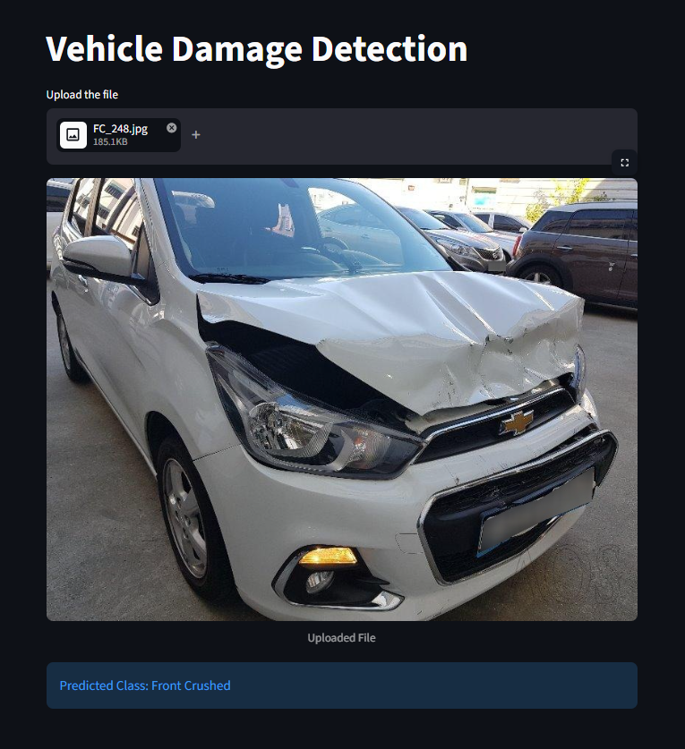

# Car Damage Prediction Using Deep Learning

## Project Overview

Car Damage Prediction is a Deep Learning project that uses a trained PyTorch model to predict the damage class of a vehicle from an uploaded image. The model achieves **80% accuracy** on the evaluated dataset.

The project provides a simple web interface built with Streamlit, allowing users to upload vehicle images and view the model's prediction.

## Application Screenshot



## Objectives

* Build an image-based vehicle damage prediction application.
* Use **ResNet50** for transfer learning with a pretrained model.
* Train the model on approximately **1,700 vehicle images** across six target classes:

  * Front Normal
  * Front Crushed
  * Front Breakage
  * Rear Normal
  * Rear Crushed
  * Rear Breakage
* Achieve **80% model accuracy**.
* Load the trained PyTorch model for inference.
* Develop an interactive web interface using Streamlit.
* Evaluate model performance using classification metrics.
* Understand the deployment workflow of a Deep Learning project.

## Technologies Used

* **Python** — Programming language
* **PyTorch** — Deep Learning framework
* **Streamlit** — Web application interface
* **Pillow (PIL)** — Image handling
* **NumPy** — Numerical operations

## Project Workflow

1. **Image Upload:** The user uploads a vehicle image in JPG or PNG format through the Streamlit application.
2. **Image Storage:** The uploaded image is temporarily saved as `temp_file.jpg`.
3. **Image Processing:** The image is prepared for the trained model.
4. **Model Inference:** The `predict()` function in `model_helper.py` loads and uses the trained PyTorch model to generate a prediction.
5. **Prediction Display:** The predicted class is displayed in the Streamlit interface.

## Installation and Setup

### Install Dependencies

Install the required Python packages:

```bash
pip install -r requirements.txt
```

Ensure that `requirements.txt` is present in the project root directory.

### Run the Application

From the project root directory, run:

```bash
streamlit run app/app.py
```

Streamlit will provide a local URL that you can open in your web browser.

## How to Use

1. Start the Streamlit application.
2. Open the application in your browser.
3. Upload a vehicle image in JPG or PNG format.
4. View the uploaded image.
5. Check the predicted damage class displayed by the application.

## Key Learnings

* Applying transfer learning to an image classification problem.
* Loading trained PyTorch model parameters for inference.
* Processing user-uploaded images for prediction.
* Integrating a Deep Learning model with Streamlit.
* Organizing a Deep Learning project into application and model directories.
